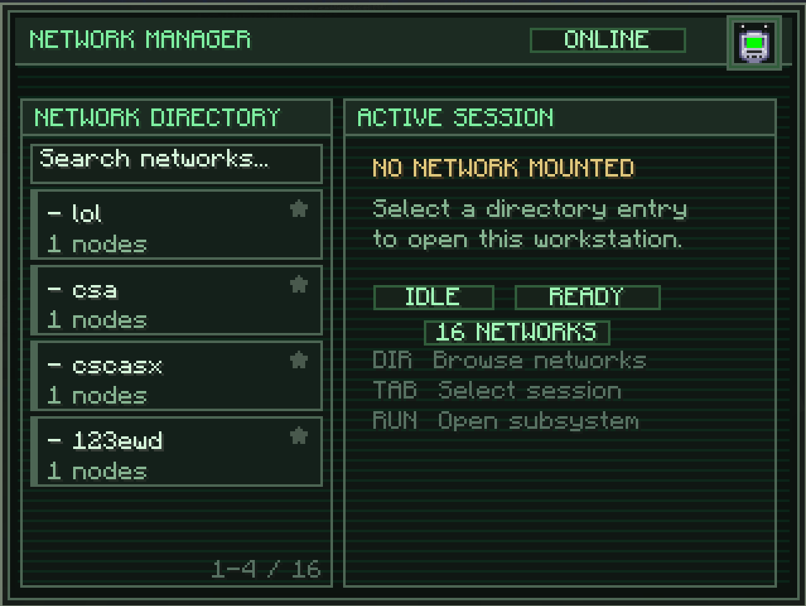
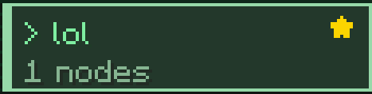

---
navigation:
  title: Network Directory
  parent: computer/index.md
  position: 1
---

# Network Directory

The left panel of the Computer screen. Lists every network on the server and lets you pick which one to mount.

## What The List Shows

Each entry in the directory shows the **network name** (the default is literally `Network` — any other text means someone renamed it) and the **node count** for that network. Pinned networks get a highlighted star in the top-right corner of their entry; unpinned ones show a dim star.

- The `>` prefix next to the name marks the entry as **selected** — it is not mounted yet, just highlighted. Use **Primary Interaction (default: Left Click)** again (or use it on **RUN**, or twice on the entry) to mount.
- The yellow filled star means this network is pinned (see below).

## Search

The text field at the top of the directory filters the list by substring match on the network name. Up to 32 characters. Case-insensitive. Clear it to see every network again.

## Groups

A network named with a slash joins a group: `Base/Furnaces` and `Base/Smelt` are listed under a **Base** header, placed where the group's first network would be. Use Primary Interaction on a header to fold or unfold it. Folds last until you close the game and are shared with the node's network picker. A search opens every group with a match. Pinning a network moves its whole group up, with pinned networks first inside it.

## Pagination

Only 4 entries fit per page. The footer shows `1-4 / 16` — the range of rows currently shown and the total row count, group headers included. Scroll the mouse wheel over the directory to page through the rest.

## Pinning (Starred Networks)

Use Primary Interaction on the **star** icon at the right edge of an entry to toggle the pin. Pinned networks sort to the top of the list — handy when you have dozens of networks and only care about a few.

Pinning state is stored on the Computer block, not on your player or on the network itself. Different Computers can have different pinned sets, and if the block is ever broken the pins reset.

## Idle Session Pane

Until you mount a network, the right-hand pane shows a small help block with three keyboard hints:

- **DIR** — Browse networks (this is where you already are, the directory).
- **TAB** — Select session (pick between I/O Monitor and Node Table after mounting).
- **RUN** — Open subsystem (jump into the selected subsystem).

The pane also shows the total network count badge (`16 NETWORKS` in the screenshot) and status lights (`IDLE` / `READY`) that light up as you progress through the flow.

## Mounting A Network

Use Primary Interaction on an entry once to select it, then on **RUN** (or on the entry a second time) to mount. The idle text disappears and the subsystem buttons unlock. From here you can open the [I/O Monitor](io-monitor.md) or the [Node Table](node-table.md).

To switch networks, hit **EXIT** on the subsystem page to return to the directory, then pick another one.
